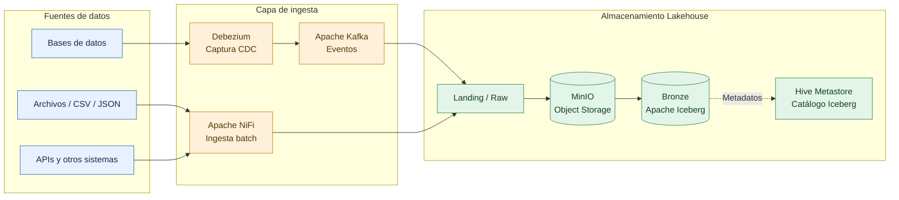
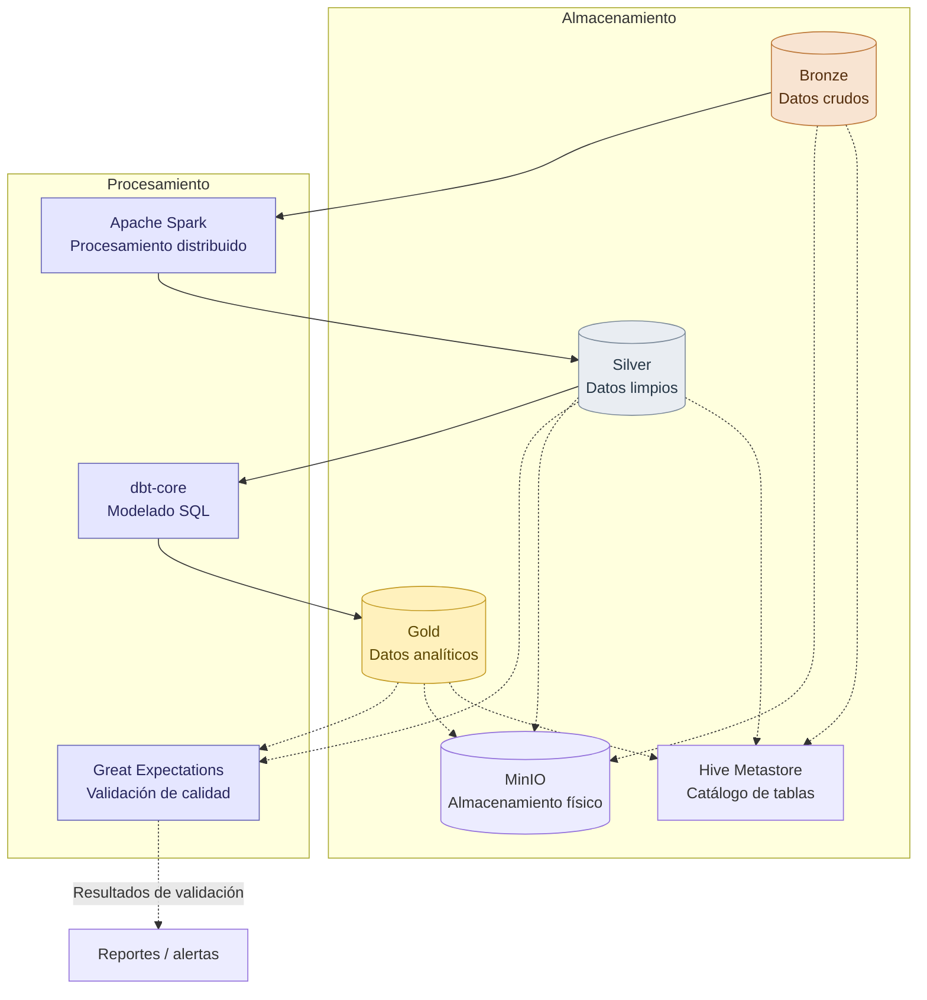
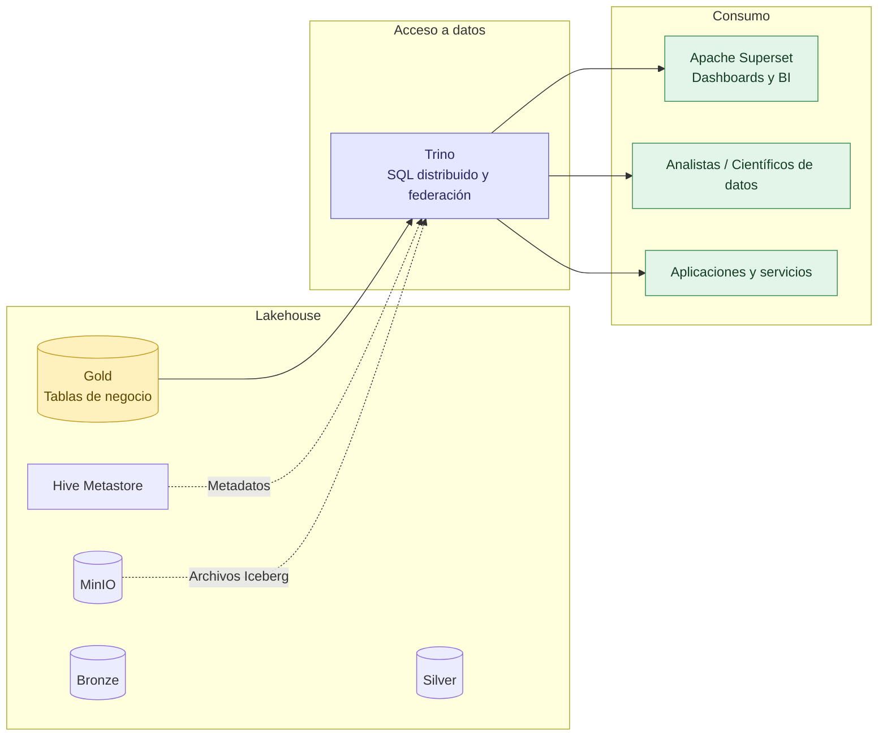
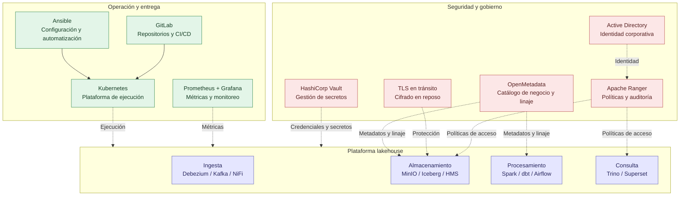
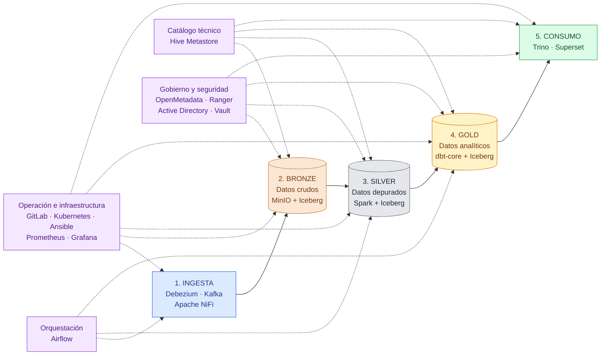
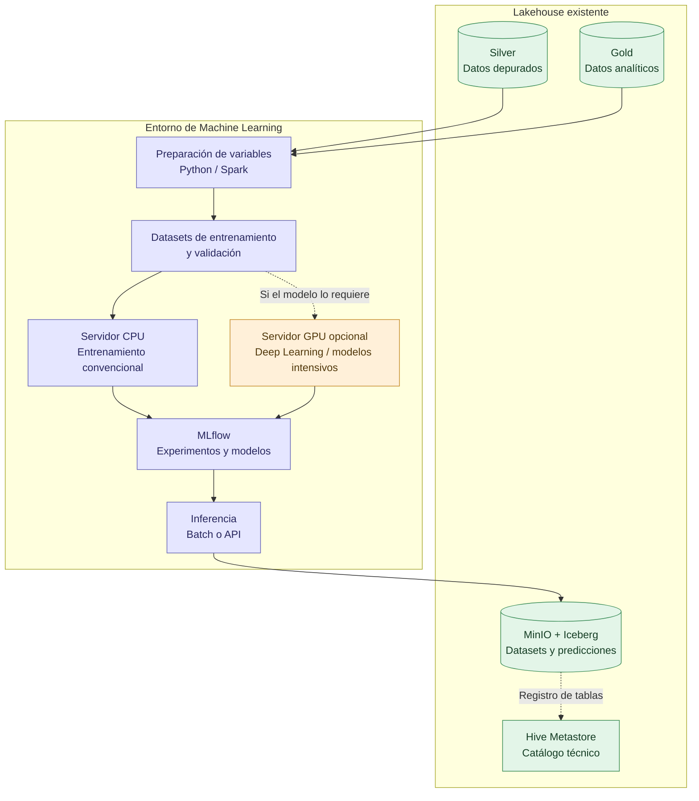
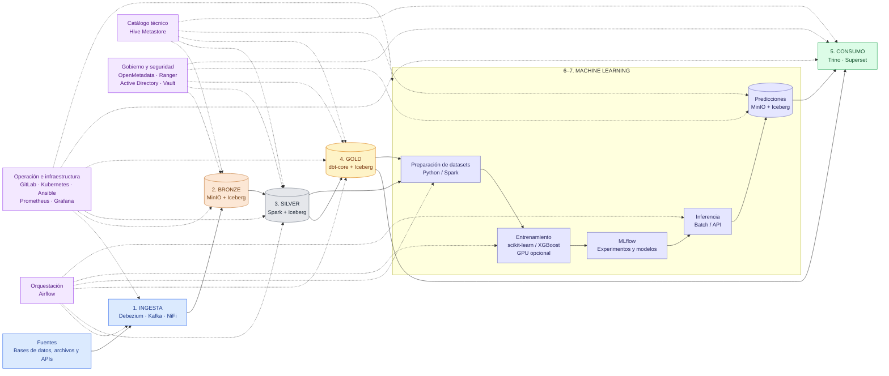
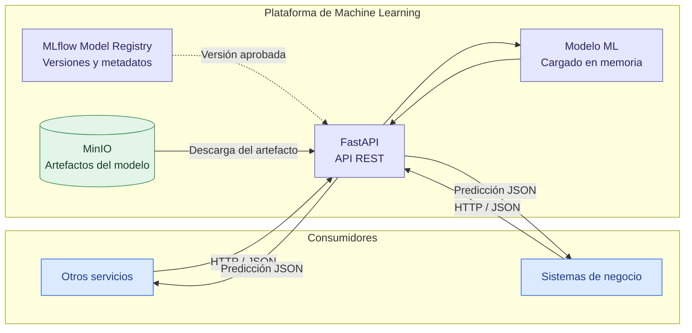

# 1. Ingesta y almacenamiento — Landing / Bronze

Objetivo: centralizar datos de fuentes operacionales y archivos en el almacenamiento de objetos,
conservando los datos originales y registrando las tablas Iceberg en el catálogo.

# 2. Procesamiento y transformación — Medallion

Objetivo: transformar los datos progresivamente, desde los registros originales hasta modelos analíticos confiables. Spark realiza el procesamiento distribuido; dbt gestiona el modelado SQL, y Great Expectations valida la calidad.

# 3. Consumo y analítica

Objetivo: ofrecer un punto de acceso SQL a los datos analíticos mediante Trino, con Superset como herramienta de visualización y con posibilidad de acceso desde otras aplicaciones.

# 4. Servicios transversales e infraestructura

Objetivo: representar los servicios compartidos que dan soporte a toda la plataforma, sin repetirlos en los diagramas de flujo de datos.

# 5. Diagrama general — Arquitectura integral del Lakehouse

Lectura del diagrama:
- Flujo principal: ingesta → Bronze → Silver → Gold → consumo.
- Catálogo: Hive Metastore registra las tablas Iceberg utilizadas en las capas del lakehouse y consultadas por Trino.
- Orquestación: Airflow coordina los pipelines.
- Gobierno y seguridad: OpenMetadata, Ranger, Active Directory y Vault proporcionan capacidades transversales.
- Operación: GitLab, Kubernetes, Ansible y Prometheus/Grafana soportan despliegue y monitoreo.
MinIO es el almacenamiento físico compartido de Bronze, Silver y Gold; Iceberg es el formato de tablas. El cifrado en reposo y TLS deben configurarse como controles de infraestructura y comunicación, respectivamente.

# 6. Integración de Machine Learning con Medallion e infraestructura GPU

**Objetivo:** identificar el punto de conexión entre el Lakehouse y el entorno de ML, así como los recursos de cómputo necesarios.

- **Origen de datos:** Silver proporciona datos depurados; Gold aporta variables e indicadores de negocio. No es necesario entrenar directamente sobre Bronze, salvo para casos específicos.
- **Almacenamiento:** los datasets preparados y las predicciones se pueden persistir en MinIO mediante tablas Iceberg cuando corresponda.
- **Servidor CPU:** suficiente para comenzar con regresión, clasificación y muchos modelos tabulares tradicionales.
- **Servidor GPU:** recurso opcional para entrenamiento o inferencia que aproveche aceleración por GPU. Puede ser un nodo dedicado del clúster Kubernetes o un servidor separado.
- **MLflow:** registra experimentos y versiones de modelos; no reemplaza al almacenamiento Lakehouse.
- **Catálogo:** Hive Metastore mantiene los metadatos de las tablas Iceberg, no el registro de modelos.

La GPU no es un requisito para toda la plataforma ni para todos los modelos. Su necesidad debe determinarse mediante el caso de uso, el volumen de datos, el tiempo de entrenamiento y los requisitos de inferencia.

# 7. Flujo de Machine Learning y MLOps

```mermaid
flowchart LR
    DATA[("Silver / Gold<br/>MinIO + Iceberg")]
    ORQ["Airflow<br/>Orquestación"]
    PREP["Python / Spark<br/>Preparación de datos"]
    TRAIN["Entrenamiento<br/>scikit-learn / XGBoost<br/>GPU opcional"]
    MLFLOW["MLflow<br/>Experimentos y registro"]
    VALID{"Validación<br/>del modelo"}
    DEPLOY["GitLab CI/CD<br/>Despliegue controlado"]
    SERV["Inferencia<br/>API o proceso batch"]
    OUT[("Predicciones<br/>MinIO + Iceberg")]
    MON["Monitoreo<br/>Calidad, deriva y métricas"]

    DATA --> ORQ
    ORQ --> PREP
    PREP --> TRAIN
    TRAIN --> MLFLOW
    MLFLOW --> VALID
    VALID -->|Aprobado| DEPLOY
    VALID -->|Rechazado| TRAIN
    DEPLOY --> SERV
    SERV --> OUT
    OUT --> MON
    MON -. "Señales para evaluar<br/>reentrenamiento" .-> ORQ

    classDef data fill:#e3f5e8,stroke:#3a8c57,color:#153d24
    classDef process fill:#e5e6ff,stroke:#6664b5,color:#28275e
    classDef decision fill:#fff0d9,stroke:#c58b2b,color:#51380b
    class DATA,OUT data
    class ORQ,PREP,TRAIN,MLFLOW,DEPLOY,SERV,MON process
    class VALID decision
```

**Objetivo:** representar el ciclo de vida de un modelo, desde los datos hasta su ejecución en producción.

1. Airflow coordina la preparación de datos y el entrenamiento.
2. Python, scikit-learn o XGBoost entrenan el modelo; Spark puede utilizarse cuando el volumen de datos lo justifique.
3. MLflow registra experimentos, métricas y versiones de los modelos.
4. El modelo se valida con criterios técnicos y de negocio antes de aprobar su despliegue.
5. GitLab CI/CD controla el proceso de entrega; la inferencia se ejecuta como proceso batch o servicio API.
6. Las predicciones se almacenan en el Lakehouse y se monitorean para detectar degradación.

El reentrenamiento no debe reemplazar automáticamente un modelo productivo sin validación. La promoción debe estar sujeta a criterios de aceptación y controles definidos.

# 8. Diagrama general — Arquitectura objetivo Lakehouse + Machine Learning

**Objetivo:** mostrar cómo se incorpora ML a la arquitectura objetivo sin crear un Lakehouse independiente.

- **Flujo principal:** ingesta → Bronze → Silver → Gold → consumo analítico.
- **Conexión con ML:** los datos depurados de Silver y los modelos analíticos de Gold alimentan la preparación de datasets para entrenamiento.
- **Resultados:** las predicciones se almacenan en MinIO/Iceberg y quedan disponibles para consultas con Trino y visualización en Superset.
- **Orquestación:** Airflow coordina los procesos de datos y ML.
- **MLOps:** MLflow administra experimentos y modelos; GitLab CI/CD y Kubernetes soportan el despliegue.
- **Infraestructura GPU:** se incorpora como capacidad de cómputo opcional para las cargas que lo requieran, sin convertirla en dependencia de toda la plataforma.
- **Servicios transversales:** catálogo, seguridad, gobierno y observabilidad mantienen su función compartida.

La arquitectura representa una capacidad futura: los componentes de ML pueden incorporarse gradualmente cuando exista un caso de uso priorizado, datos suficientes y requisitos definidos de entrenamiento e inferencia.

# 9. Consumo de modelos ML mediante APIs

**Objetivo:** exponer los modelos de Machine Learning mediante APIs REST para que otros servicios y sistemas de negocio puedan solicitar predicciones sin acceder directamente a la infraestructura de entrenamiento ni al Lakehouse.

**Componentes y responsabilidades:**

- **FastAPI:** expone los endpoints REST, recibe solicitudes HTTP con datos en formato JSON y devuelve las predicciones.
- **MLflow Model Registry:** registra las versiones de los modelos, sus metadatos y su estado de aprobación.
- **MinIO:** almacena los artefactos de los modelos entrenados, como archivos serializados de scikit-learn o XGBoost.
- **Modelo ML:** se carga en memoria desde el artefacto almacenado en MinIO para realizar las predicciones.
- **Otros servicios:** consumen la API mediante HTTP/HTTPS, enviando los datos requeridos y recibiendo las predicciones en formato JSON.

**Flujo de funcionamiento:**

1. Un modelo entrenado se registra en MLflow y su artefacto se almacena en MinIO.
2. FastAPI identifica la versión aprobada y carga el modelo desde MinIO, normalmente al iniciar o actualizar el servicio.
3. Otros sistemas envían solicitudes a la API con los datos necesarios para realizar una predicción.
4. FastAPI ejecuta el modelo y devuelve el resultado al sistema solicitante.

**Infraestructura y seguridad:** el servicio puede desplegarse como contenedor en Kubernetes. Deben implementarse autenticación, autorización, TLS y controles de acceso a MinIO y MLflow según las políticas corporativas.

**Consideración arquitectónica:** MinIO almacena los archivos de los modelos, mientras que MLflow administra sus versiones y metadatos. No es necesario almacenar los modelos como tablas Iceberg; ambos componentes pueden utilizar la infraestructura de almacenamiento de la plataforma con funciones diferenciadas.

# Capas y herramientas para Machine Learning y MLOps

| Etapa | Capa | Herramienta |
|---|---|---|
| Machine Learning | Lenguaje de desarrollo y análisis | Python |
| Machine Learning | Entrenamiento de modelos tradicionales | scikit-learn |
| Machine Learning | Modelos tabulares avanzados | XGBoost / LightGBM |
| Machine Learning | Preparación y procesamiento de datasets | Apache Spark + Python |
| Machine Learning | Entorno de desarrollo interactivo | JupyterHub |
| Machine Learning | Registro de experimentos, métricas y versiones de modelos | MLflow Tracking + Model Registry |
| Machine Learning | Almacenamiento de artefactos de modelos | MinIO |
| Machine Learning | Cómputo acelerado para entrenamiento e inferencia intensiva | Servidor GPU / Kubernetes con GPU (opcional) |
| MLOps | Orquestación de pipelines de entrenamiento y evaluación | Apache Airflow |
| MLOps | Validación y evaluación de modelos | Python + scikit-learn |
| MLOps | Versionamiento y despliegue de modelos | GitLab CI/CD + Kubernetes |
| MLOps | Monitoreo de deriva de datos y desempeño de modelos | Evidently |
| Inferencia / Consumo | Exposición de modelos mediante API REST | FastAPI |
| Inferencia / Consumo | Ejecución de predicciones batch | Python / Apache Spark + Airflow |
| Inferencia / Consumo | Almacenamiento de predicciones e históricos | MinIO + Apache Iceberg |
| Inferencia / Consumo | Consulta y análisis de predicciones | Trino + Apache Superset |
| Transversal | Métricas y monitoreo de infraestructura y servicios ML | Prometheus + Grafana |
| Transversal | Seguridad y gestión de credenciales | Active Directory + HashiCorp Vault |
| Transversal | Plataforma de ejecución de servicios ML | Kubernetes |
