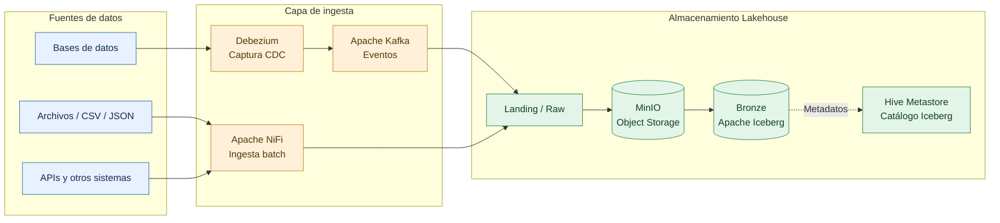
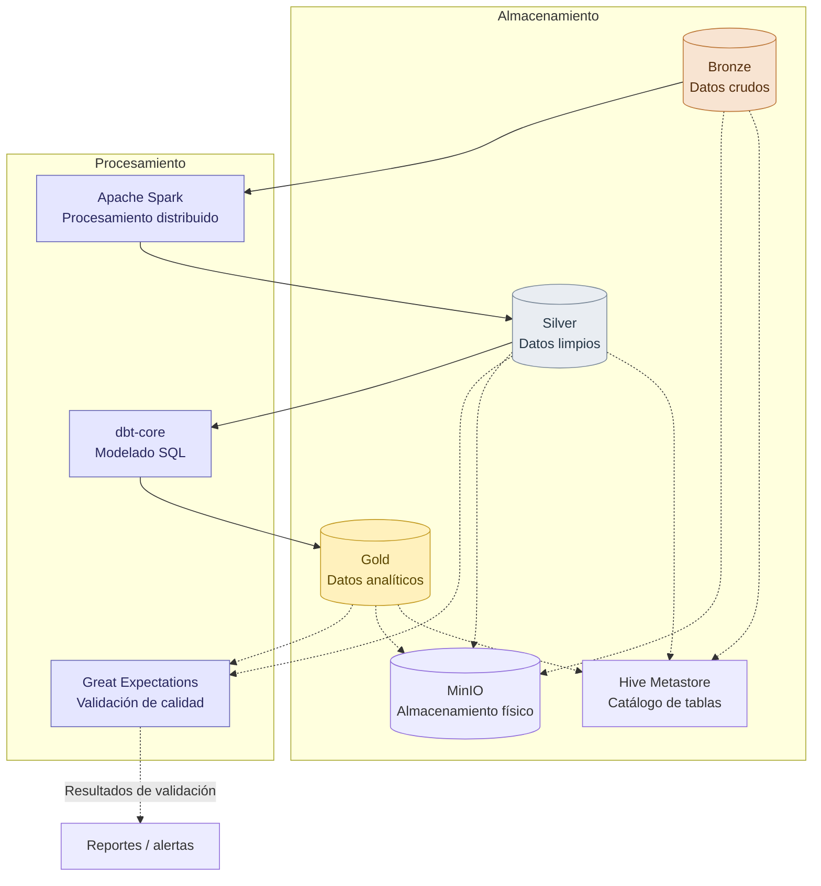
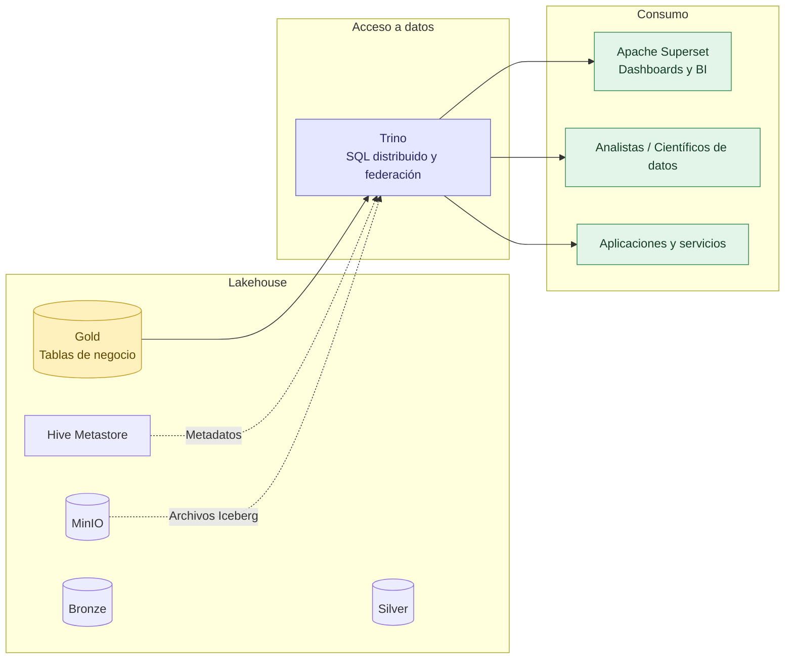
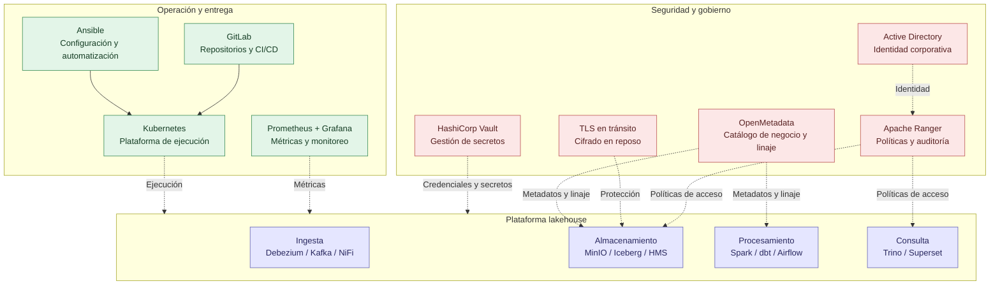
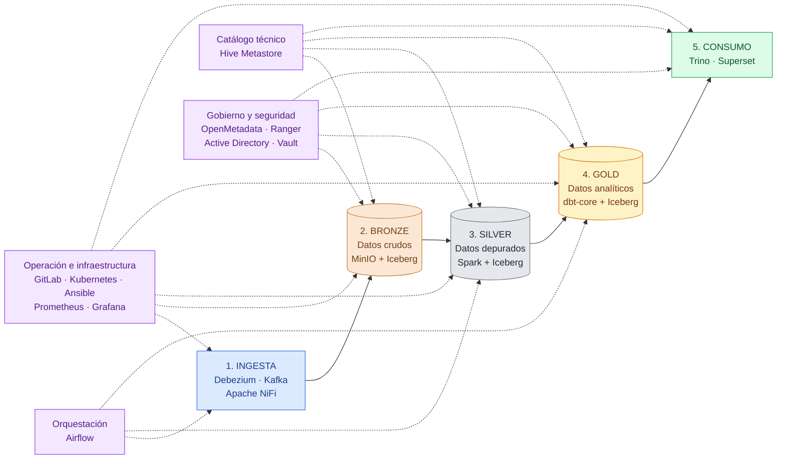

# 1. Ingesta y almacenamiento — Landing / Bronze

Objetivo: centralizar datos de fuentes operacionales y archivos en el almacenamiento de objetos,
conservando los datos originales y registrando las tablas Iceberg en el catálogo.

# 2. Procesamiento y transformación — Medallion

Objetivo: transformar los datos progresivamente, desde los registros originales hasta modelos analíticos confiables. Spark realiza el procesamiento distribuido; dbt gestiona el modelado SQL, y Great Expectations valida la calidad.

# 3. Consumo y analítica

Objetivo: ofrecer un punto de acceso SQL a los datos analíticos mediante Trino, con Superset como herramienta de visualización y con posibilidad de acceso desde otras aplicaciones.

# 4. Servicios transversales e infraestructura

Objetivo: representar los servicios compartidos que dan soporte a toda la plataforma, sin repetirlos en los diagramas de flujo de datos.

# 5. Diagrama general — Arquitectura integral del Lakehouse

Lectura del diagrama:
- Flujo principal: ingesta → Bronze → Silver → Gold → consumo.
- Catálogo: Hive Metastore registra las tablas Iceberg utilizadas en las capas del lakehouse y consultadas por Trino.
- Orquestación: Airflow coordina los pipelines.
- Gobierno y seguridad: OpenMetadata, Ranger, Active Directory y Vault proporcionan capacidades transversales.
- Operación: GitLab, Kubernetes, Ansible y Prometheus/Grafana soportan despliegue y monitoreo.
MinIO es el almacenamiento físico compartido de Bronze, Silver y Gold; Iceberg es el formato de tablas. El cifrado en reposo y TLS deben configurarse como controles de infraestructura y comunicación, respectivamente.
